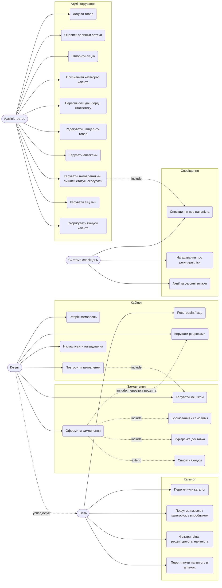
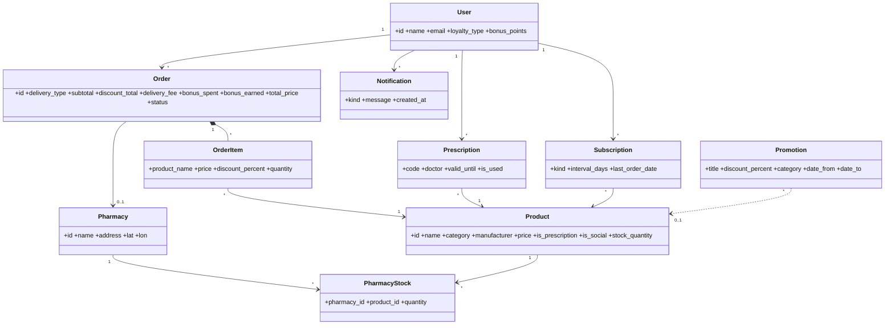
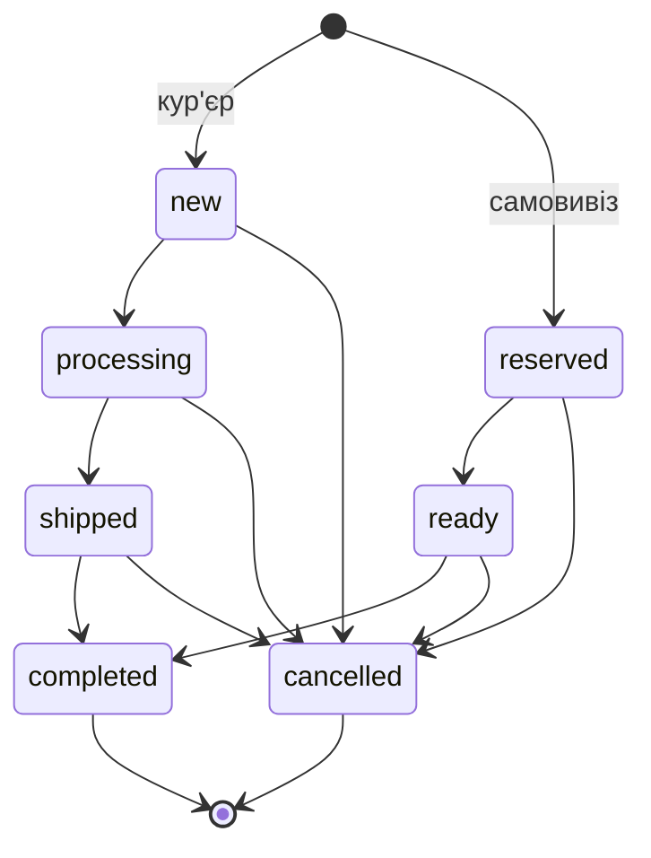
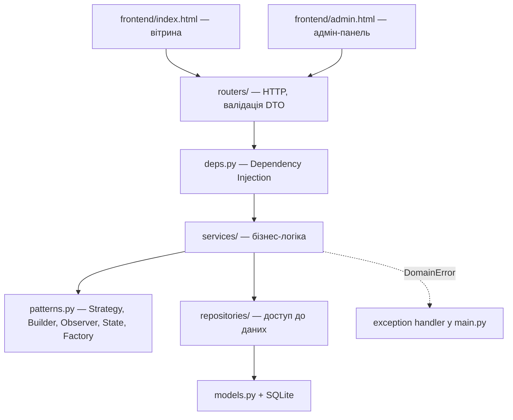

# PharmPlus — аналіз та проєктування

## 1. Предметна область і Use Case

**Актори:** Гість, Клієнт (звичайний / соціальний / преміум), Адміністратор, Система сповіщень (внутрішній актор за розкладом).

## 2. Діаграма класів

Діаграму розбито на три частини, щоб її можна було прочитати: (2.1) сутності предметної області, (2.2) GoF-патерни, (2.3) шари сервісів і репозиторіїв. Разом вони складають діаграму класів системи в цілому.

### 2.1 Сутності предметної області

### 2.2 GoF-патерни (кольорами позначено патерни)

| Колір | Патерн |
|---|---|
| жовтий | Strategy |
| помаранчевий | Builder |
| зелений | Observer |
| блакитний | State |
| коричневий | Simple Factory |
| рожевий | Facade |

```mermaid
classDiagram
    %% ── Strategy: категорії клієнтів ──
    class LoyaltyStrategy { <<abstract>> +label +bonus_rate +free_delivery +discount_rate(product) }
    class RegularDiscount
    class SocialDiscount
    class PremiumDiscount
    LoyaltyStrategy <|-- RegularDiscount
    LoyaltyStrategy <|-- SocialDiscount
    LoyaltyStrategy <|-- PremiumDiscount

    %% ── Simple Factory ──
    class StrategyFactory { <<Simple Factory>> +get_strategy(loyalty_type) LoyaltyStrategy }
    class StateFactory { <<Simple Factory>> +get_state(status) OrderState }
    StrategyFactory ..> LoyaltyStrategy : створює
    StateFactory ..> OrderState : створює

    %% ── Builder ──
    class OrderBuilder { +set_user(user) +set_delivery(type, pharmacy, address) +add_item(product, qty, rate) +use_bonuses(amount) +get_result() }
    OrderBuilder ..> LoyaltyStrategy : розрахунок знижок і бонусів

    %% ── Observer ──
    class OrderSubject { +attach(observer) +notify(message) }
    class NotificationObserver { <<abstract>> +update(message, kind) }
    class DbNotifier
    class EmailNotifier
    class SmsNotifier
    NotificationObserver <|-- DbNotifier
    NotificationObserver <|-- EmailNotifier
    NotificationObserver <|-- SmsNotifier
    OrderSubject o-- NotificationObserver

    %% ── State: життєвий цикл замовлення ──
    class OrderState { <<abstract>> +name +label +next_states +can_move_to(target) +is_final }
    class NewState
    class ProcessingState
    class ShippedState
    class ReservedState
    class ReadyState
    class CompletedState
    class CancelledState
    OrderState <|-- NewState
    OrderState <|-- ProcessingState
    OrderState <|-- ShippedState
    OrderState <|-- ReservedState
    OrderState <|-- ReadyState
    OrderState <|-- CompletedState
    OrderState <|-- CancelledState

    class Order { +status }
    Order ..> OrderState : status визначає стан

    style LoyaltyStrategy fill:#fff9c4,stroke:#555,color:#000
    style RegularDiscount fill:#fff9c4,stroke:#555,color:#000
    style SocialDiscount fill:#fff9c4,stroke:#555,color:#000
    style PremiumDiscount fill:#fff9c4,stroke:#555,color:#000
    style StrategyFactory fill:#d7ccc8,stroke:#555,color:#000
    style StateFactory fill:#d7ccc8,stroke:#555,color:#000
    style OrderBuilder fill:#ffe0b2,stroke:#555,color:#000
    style OrderSubject fill:#c8e6c9,stroke:#555,color:#000
    style NotificationObserver fill:#c8e6c9,stroke:#555,color:#000
    style DbNotifier fill:#c8e6c9,stroke:#555,color:#000
    style EmailNotifier fill:#c8e6c9,stroke:#555,color:#000
    style SmsNotifier fill:#c8e6c9,stroke:#555,color:#000
    style OrderState fill:#bbdefb,stroke:#555,color:#000
    style NewState fill:#bbdefb,stroke:#555,color:#000
    style ProcessingState fill:#bbdefb,stroke:#555,color:#000
    style ShippedState fill:#bbdefb,stroke:#555,color:#000
    style ReservedState fill:#bbdefb,stroke:#555,color:#000
    style ReadyState fill:#bbdefb,stroke:#555,color:#000
    style CompletedState fill:#bbdefb,stroke:#555,color:#000
    style CancelledState fill:#bbdefb,stroke:#555,color:#000
```

Функції `get_strategy` і `get_state` у коді є функціями модуля `patterns.py`; на діаграмі вони показані як класи-фабрики для наочності.

### 2.3 Сервіси та репозиторії

Роутери (`routers/*`) викликають лише сервіси; сервіси працюють із даними тільки через репозиторії (Dependency Injection у `deps.py`). Рожевим позначено Facade.

```mermaid
classDiagram
    class Repository { +add(obj) +delete(obj) +flush() +commit() +refresh(obj) }
    class ProductRepository
    class PromotionRepository
    class PharmacyRepository
    class UserRepository
    class PrescriptionRepository
    class SubscriptionRepository
    class NotificationRepository
    class OrderRepository
    Repository <|-- ProductRepository
    Repository <|-- PromotionRepository
    Repository <|-- PharmacyRepository
    Repository <|-- UserRepository
    Repository <|-- PrescriptionRepository
    Repository <|-- SubscriptionRepository
    Repository <|-- NotificationRepository
    Repository <|-- OrderRepository

    class CatalogService { +search(...) +get(id) +active_promotions() }
    class PharmacyService { +nearest(lat, lon, need) +nearest_with_stock(product_id, lat, lon) }
    class UserService { +register() +login() +list_prescriptions() +add_prescription() +add_subscription() }
    class NotificationService { +build(user_id, lat, lon) }
    class OrderService { <<Facade>> +preview(req) +place(req) +history(user_id) }
    class AdminService { +CRUD товарів, аптек, акцій +set_pharmacy_stock() +set_loyalty() +adjust_bonus() }
    class AdminOrderService { +list(status) +change_status(order_id, target) }
    class ReportService { +dashboard(days) }

    CatalogService ..> ProductRepository
    CatalogService ..> PromotionRepository
    PharmacyService ..> PharmacyRepository
    PharmacyService ..> ProductRepository
    UserService ..> UserRepository
    UserService ..> ProductRepository
    UserService ..> PrescriptionRepository
    UserService ..> SubscriptionRepository
    NotificationService ..> UserService
    NotificationService ..> PharmacyService
    NotificationService ..> SubscriptionRepository
    NotificationService ..> NotificationRepository
    NotificationService ..> PromotionRepository
    OrderService ..> UserRepository
    OrderService ..> ProductRepository
    OrderService ..> PharmacyRepository
    OrderService ..> PromotionRepository
    OrderService ..> PrescriptionRepository
    OrderService ..> SubscriptionRepository
    OrderService ..> OrderRepository
    OrderService ..> NotificationRepository
    AdminService ..> ProductRepository
    AdminService ..> PharmacyRepository
    AdminService ..> PromotionRepository
    AdminService ..> UserRepository
    AdminService ..> OrderRepository
    AdminOrderService ..> OrderRepository
    AdminOrderService ..> UserRepository
    AdminOrderService ..> ProductRepository
    AdminOrderService ..> PharmacyRepository
    AdminOrderService ..> NotificationRepository
    ReportService ..> OrderRepository
    ReportService ..> ProductRepository
    ReportService ..> UserRepository
    ReportService ..> PharmacyRepository

    class OrderBuilder
    class OrderSubject
    class StrategyFactory { <<Simple Factory>> }
    class StateFactory { <<Simple Factory>> }
    OrderService ..> OrderBuilder : Builder
    OrderService ..> OrderSubject : Observer
    OrderService ..> StrategyFactory
    AdminOrderService ..> StateFactory : State
    AdminOrderService ..> OrderSubject : Observer
    ReportService ..> StateFactory

    style OrderService fill:#f8bbd0,stroke:#555,color:#000
    style OrderBuilder fill:#ffe0b2,stroke:#555,color:#000
    style OrderSubject fill:#c8e6c9,stroke:#555,color:#000
    style StrategyFactory fill:#d7ccc8,stroke:#555,color:#000
    style StateFactory fill:#d7ccc8,stroke:#555,color:#000
```

## 3. GoF-шаблони

| Шаблон | Де застосовано | Навіщо | Стан |
|---|---|---|---|
| **Strategy** | `LoyaltyStrategy` → `Regular/Social/PremiumDiscount` | алгоритм знижки, бонусу й доставки залежить від категорії клієнта; нову категорію додаємо без зміни коду замовлення | реалізовано |
| **Builder** | `OrderBuilder` | покроково збирає замовлення (клієнт, позиції, доставка, бонуси) і рахує підсумки | реалізовано |
| **Observer** | `OrderSubject` + `DbNotifier`, `EmailNotifier`, `SmsNotifier` | подія оформлення замовлення розсилається незалежним каналам | реалізовано |
| **Simple Factory** | `get_strategy(loyalty_type)` | вибір стратегії за рядком із БД в одному місці | реалізовано |
| **Facade** | `services/order_service.py` → `OrderService` | один вхід для сценарію «розрахувати / оформити замовлення»: ховає Factory, Builder, Observer і 8 репозиторіїв | реалізовано |
| **Repository** | пакет `repositories/` | уся робота з SQLAlchemy ізольована; сервіси працюють лише з репозиторіями | реалізовано |
| **State** | `OrderState` → `New/Processing/Shipped/Reserved/Ready/Completed/CancelledState` | кожен статус замовлення сам визначає, у які статуси можна перейти; адмін-панель не містить `if status == ...` | реалізовано |
| Decorator | знижки акцій поверх знижки клієнта | зараз береться `max()` двох знижок | опційно |

**Як шаблони працюють разом (клієнт):** `OrderService` (Facade) отримує запит → `get_strategy` (Factory) обирає стратегію → `OrderBuilder` використовує її для розрахунку → після збереження `OrderSubject` сповіщає observer-ів.

У адмін-сценарії **State** працює разом з **Observer**: `AdminOrderService.change_status` перевіряє перехід через `get_state(...).can_move_to(...)`, а після зміни `OrderSubject` розсилає клієнту сповіщення (БД, email, SMS).

## 4. Архітектура

Клієнт-серверний REST-додаток: **UI (HTML + JS)** → **FastAPI-роутери** → **сервіси** → **репозиторії** → **SQLAlchemy / SQLite**.

| Шар | Файли | Відповідальність |
|---|---|---|
| Presentation | `routers/*`, `schemas.py` | маршрути, DTO, перетворення помилок у HTTP |
| Application | `services/*` | сценарії: каталог, замовлення (Facade), кабінет, сповіщення, адмін |
| Domain | `patterns.py`, `models.py` | правила знижок/бонусів, сутності |
| Infrastructure | `repositories/*`, `database.py`, `seed.py` | БД, транзакції, початкові дані |

### GRASP
- **Information Expert** — `OrderBuilder` знає позиції, тому сам рахує суму; `LoyaltyStrategy` знає правила знижки.
- **Creator** — `Order` створює свої `OrderItem`.
- **Low Coupling / High Cohesion** — патерни винесені в `patterns.py`, початкові дані — в `seed.py`.
- **Polymorphism** — категорії клієнтів і канали сповіщень.
- **Controller** — роутери лише приймають запит і делегують сервісу.
- **Pure Fabrication** — репозиторії та `pricing.py` не відповідають жодній сутності предметної області.
- **Protected Variations** — нові категорії/канали додаються без зміни існуючого коду.

### SOLID
- **S** — кожен шар і сервіс має одну причину для змін (роутери — HTTP, сервіси — сценарії, репозиторії — SQL).
- **O** — нова стратегія або observer додається розширенням, не зміною.
- **L** — усі стратегії взаємозамінні через `discount_rate()`.
- **I** — вузькі абстракції (`discount_rate`, `update`).
- **D** — `OrderBuilder` залежить від `LoyaltyStrategy`; сервіси отримують репозиторії через конструктор (`deps.py`), а не створюють самі; `DbNotifier` залежить від репозиторію, а не від сесії БД.

## 5. REST API (основне)

| Метод | URL | Призначення |
|---|---|---|
| GET | `/products/` | каталог, пошук, фільтри, сортування |
| GET | `/pharmacies/nearest` | аптеки за відстанню та наявністю |
| POST | `/orders/preview`, `/orders/create-full` | розрахунок і оформлення |
| GET | `/orders/user/{id}` | історія |
| GET/POST | `/users/{id}/prescriptions` | рецепти |
| GET/POST/DELETE | `/users/{id}/subscriptions` | нагадування |
| GET | `/users/{id}/notifications` | сповіщення |
| GET | `/admin/stats` | дашборд |
| GET/POST/PUT/DELETE | `/admin/products/`, `/admin/products/{id}` | CRUD товарів |
| GET/POST/PUT/DELETE | `/admin/pharmacies/`, `/admin/pharmacies/{id}` | CRUD аптек |
| GET/PUT | `/admin/pharmacies/{id}/stock` | залишки аптеки |
| GET/POST/DELETE | `/admin/promotions/`, `/admin/promotions/{id}` | акції |
| GET | `/admin/users/` | клієнти зі статистикою |
| PUT/POST | `/admin/users/{id}/loyalty`, `/admin/users/{id}/bonus` | категорія та бонуси клієнта |
| GET/PUT | `/admin/orders/`, `/admin/orders/{id}/status` | замовлення та зміна статусу (State) |

Усі `/admin/*` вимагають заголовок `X-Admin-Key`. Інтерфейс — `frontend/admin.html` за адресою `/admin-panel`.
